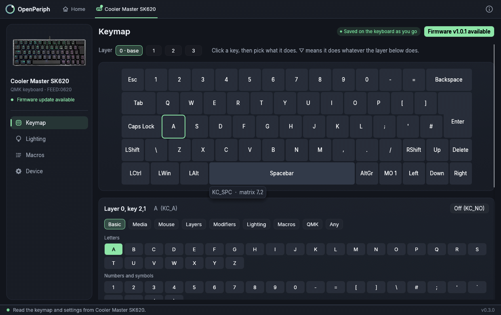
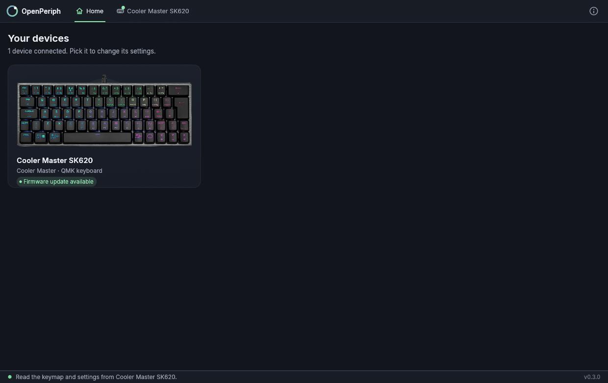
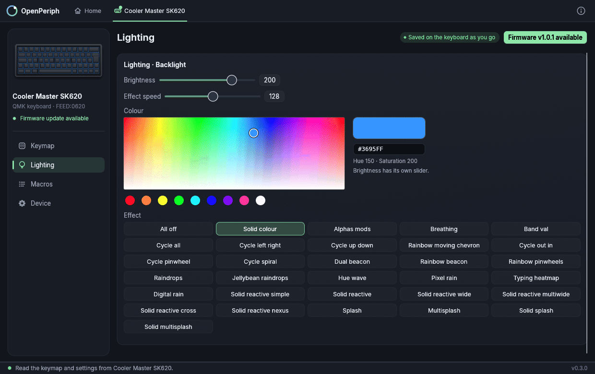
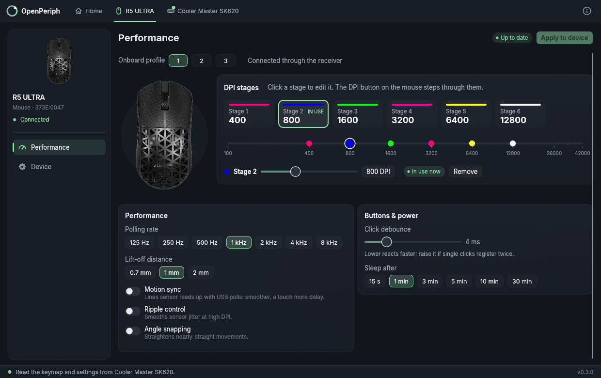
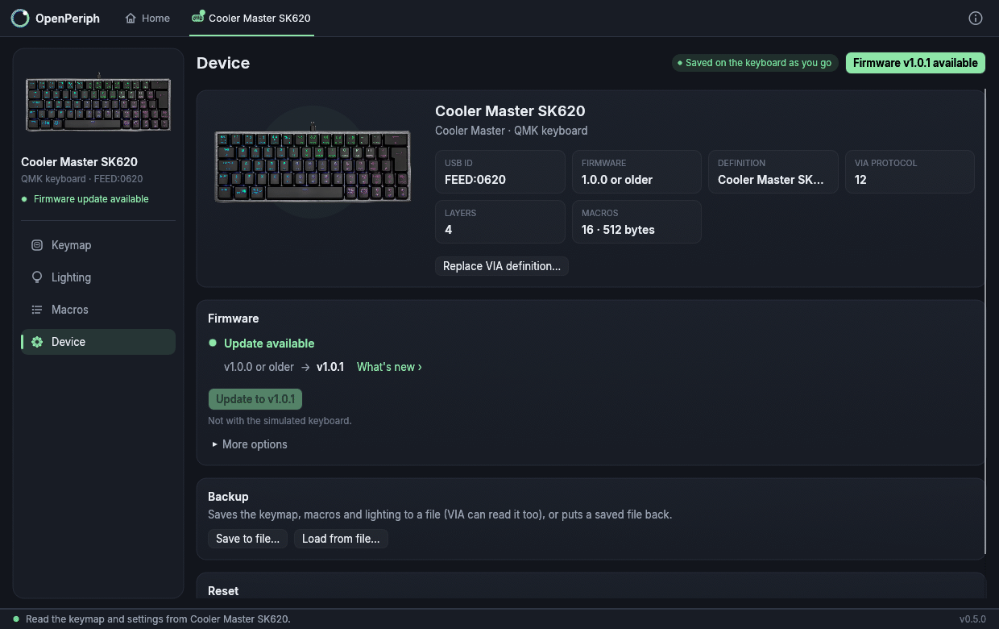

# OpenPeriph

Settings for your keyboards and mice, without the vendor software. OpenPeriph is a small app for
**Windows and Linux** that talks to devices directly over USB. You don't need an account, it
works offline, and nothing has to keep running in the background afterwards.

## What it does

- **Remap keys** on every layer: other keys, shortcuts, media and mouse keys, layers, macros.
- **Lighting**: effects, colour (with a proper colour picker), speed and brightness.
- **Macros** that type text, press shortcuts and wait.
- **Mouse settings**: DPI stages, polling rate, lift-off distance, debounce, sleep.
- **Firmware updates** for keyboards that support them, keeping your settings.
- **Backups** of a keyboard's keymap, macros and lighting.
- **Updates itself** from GitHub releases.

Plug a device in and it gets a tab along the top and a card on the Home page. Devices that aren't
plugged in stay out of the way; **About** (the ⓘ button) lists everything that's supported.

| | |
| --- | --- |
|  |  |
|  |  |

## Supported devices

| Device | What you can change | Details |
| --- | --- | --- |
| Any **QMK keyboard with VIA** | Keymap, macros, lighting, layout options, backups | [QMK and VIA keyboards](docs/devices/qmk-via.md) |
| **Cooler Master SK620** (running [our QMK firmware](https://github.com/clawntl/qmk-sk620)) | Everything above, plus firmware updates | [Cooler Master SK620](docs/devices/cooler-master-sk620.md) |
| **CIY X78** keyboard (UK ISO) | Keys on the normal and Fn layers, lighting | [CIY X78](docs/devices/ciy-x78.md) |
| **Attack Shark R5 ULTRA** mouse | DPI, polling, sensor, buttons, power | [Attack Shark R5 ULTRA](docs/devices/attack-shark-r5-ultra.md) |

## Download

Get the latest version from [Releases](https://github.com/clawntl/openperiph/releases/latest):

- **Windows:** `openperiph-setup-x64.exe` installs it with a Start menu entry and an
  uninstaller (no administrator rights needed). Or download `openperiph.exe` and just run it
  from anywhere: it's portable and installs nothing.
- **Arch Linux and CachyOS:** download the `.pkg.tar.zst` file, then
  `sudo pacman -Syu && sudo pacman -U openperiph-*-x86_64.pkg.tar.zst`.
- **Other Linux:** download `openperiph-linux-x64`, make it executable and run it.

On Linux, devices need a udev rule before you can use them without root. The Arch package
installs these rules. Otherwise, OpenPeriph shows **Allow access** and adds the rule for you. See
[Linux](docs/linux.md).

## Updates

OpenPeriph checks GitHub when it starts. If there's a newer version, it asks whether to update.
It downloads the new version, checks its SHA-256, installs it and restarts. The Arch package is
updated with pacman, and you're asked for your password.

Keyboards with firmware updates (the SK620) are checked when you plug them in, in the same way.

## Look

The app has a neutral dark theme. **About → Appearance** sets what's behind the panels: plain,
faint smoke, or a picture of your own.

## More

- [Linux](docs/linux.md): installing, udev rules, building the Arch package.
- [Development](docs/development.md): building, adding a device, releasing.
- [Protocols](docs/protocols/): how OpenPeriph talks to each device, with sources.
- [Changelog](CHANGELOG.md).

OpenPeriph isn't affiliated with QMK, VIA, Cooler Master, CIY or Attack Shark. It writes settings
to your devices' own memory: use it at your own risk.
