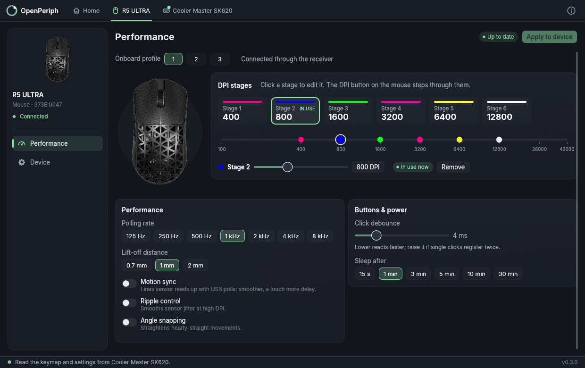

# Attack Shark R5 ULTRA

A wireless mouse. OpenPeriph works with it over the cable (USB 373E:0046) or the receiver
(373E:0047).

## What you can change

- **DPI stages**: up to 6, from 100 to 42 000 DPI, and which stage is in use.
- **Onboard profile** (1–3).
- **Polling rate**: up to 8 kHz through the receiver, up to 1 kHz over the cable.
- **Sensor**: lift-off distance, motion sync, ripple control, angle snapping, and Hunting Shark
  competitive mode (full sensor performance, at the cost of battery; only shown if the mouse's
  firmware has it).
- **Buttons and power**: click debounce, sleep timer.

OpenPeriph also shows the battery level and the mouse's firmware version. Changes are sent with
**Apply to device**.

## Notes

**High-Speed Mode** (the driver's "HyperMode") isn't included. Attack Shark's driver has it, but
their model list turns it off for the R5 Ultra, so their own driver never shows it either. Their
description says only that it improves performance, uses more power, and can't be used with 2K,
4K or 8K polling. If a firmware update turns it on for this mouse, it could be added with the same
kind of switch (`02 01 0B`, read `02 01 8B`).

The protocol comes from Attack Shark's own web driver, plus facts documented by
[Shark Deck](https://github.com/alexandrewillame/shark-deck). No code from either is included.
Details: [protocols/attack-shark-r5-ultra.md](../protocols/attack-shark-r5-ultra.md).
