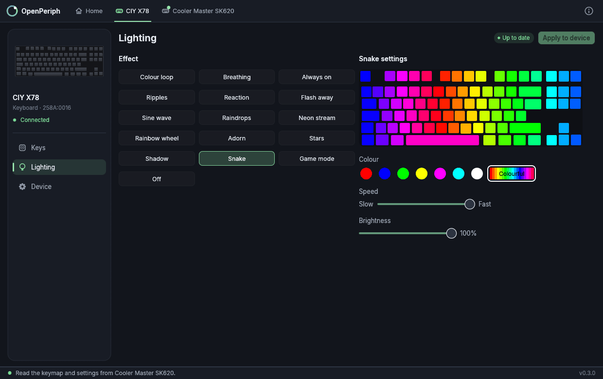

# CIY X78

The CIY X78 is a UK ISO keyboard (USB 258A:0016). It runs its own firmware, not QMK.

## What you can change

- **Keys** on the normal and **Fn** layers: another key, a shortcut, a mouse button, a media key,
  or off.
- **Lighting**: effect, colour, speed, brightness, direction, and the game-mode colour groups.

Changes are made in the app first. **Apply to device** then sends them. OpenPeriph keeps its own
copy of your key settings, because the keyboard can't report its key table back.

## Notes

The protocol was worked out from the vendor's Windows driver. No vendor code is included. Every
value, and where it came from, is in [protocols/ciy-x78.md](../protocols/ciy-x78.md) and
[protocols/ciy-x78.json](../protocols/ciy-x78.json).
