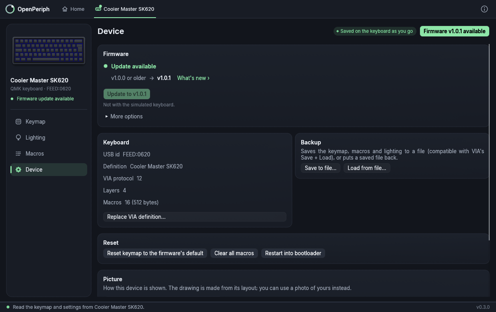

# Cooler Master SK620

The SK620 (UK ISO) can run QMK with the firmware from
[clawntl/qmk-sk620](https://github.com/clawntl/qmk-sk620). OpenPeriph includes its VIA definition,
so everything on the [QMK and VIA keyboards](qmk-via.md) page works with no import.

## Firmware updates

When the SK620 is plugged in, OpenPeriph compares the firmware version on the keyboard with the
newest [qmk-sk620 release](https://github.com/clawntl/qmk-sk620/releases). If a newer one exists,
OpenPeriph asks whether to update. The keyboard's **Device** page shows the same thing:

- **Update available** with *installed → latest* and **What's new**, and an **Update** button.
- **Up to date** when there's nothing to do.

Updating takes about 20 seconds. OpenPeriph:

1. saves your keymap, macros and lighting;
2. restarts the keyboard into its bootloader;
3. downloads the release and checks its SHA-256;
4. erases, writes and checks the firmware;
5. restarts the keyboard and puts your settings back.

Keys you never changed get the new firmware's defaults, so fixes to the default keymap still
reach you. Don't unplug the keyboard while it updates.

**More options** has **Check again**, **Reinstall**, **Flash a .bin file** (to install a build of
your own), and a switch to start from the defaults instead of keeping your settings.

## The first flash

The first time, Cooler Master's own firmware has to be replaced with the qmk-sk620 project's
`sk620_flash` tool. The chip is read-protected until it's erased with the SEL2 pads bridged. See
[qmk-sk620's flashing guide](https://github.com/clawntl/qmk-sk620/blob/main/docs/flashing.md).
After that, every update can be done from OpenPeriph.

## On Linux

The Arch package's udev rules cover both the keyboard (FEED:0620) and its bootloader
(04D9:8010). Otherwise, OpenPeriph asks for access the first time it needs each one. See
[Linux](../linux.md).

How it works: [protocols/cooler-master-sk620.md](../protocols/cooler-master-sk620.md).
